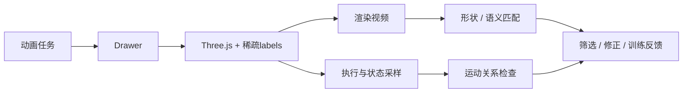

# 让自由生成的3D sketch动画具备可验证性

> **当模型自由创造物体、部件和运动时，如何让生成结果同时具有可靠的语义测量接口，使开放式动画也能被检查？**

## 研究动机

- 3D sketch animation同时包含形状设计和运动设计；可辨认的画面不保证正确的运动。
- 视觉embedding可以提供形状/语义匹配信号，但不能单独确定连接、朝向、接触、轨迹与时序是否正确。
- Three.js具有可执行、可解释的几何和变换；困难在于把任务语义绑定到真正参与渲染的部件与测量点。

## 方法方向

1. **生成与可观测性共同学习。** Drawer输出完整动画，同时给关键实体、运动部位、约束锚点设置稀疏、稳定的语义label。
2. **语义说明与真实几何绑定。** 用机器可读注释记录label用途，以实际`Object3D.name`查询世界坐标、姿态、几何与控制点。
3. **形状与运动分别验收。** 渲染视频交给embedding；代码执行状态交给任务相关的运动检查器。
4. **反馈用于改善生成。** 可用于候选筛选、修正及后续训练；需分别验证各环节的可靠性和最终动画收益。

## 必须区分的层级

- 注释可解析，不代表label存在于实际场景。
- label可查询，不代表它绑定正确部位或正确的测量点。
- Object3D原点不一定是部件中心；旋转也可能直接体现在顶点坐标中。
- 检查脚本能运行，不代表判据正确；有限时刻采样不构成连续时间物理证明。
- 分别报告接口绑定、检查器质量和生成质量；不将embedding余弦分数当作物理通过概率。

## 当前发布

- [2000条完整训练数据](../../data/teachers/movement_labels2000_v1/README.md)：原生teacher reasoning＋完整Three.js，无压缩、无截断。
- [4B标签模型：LoRA 2epochs](../../models/movement_labels2000_2ep/README.md)：包含加载所需的full-SFT基础权重和最终adapter。
- 可靠的通用语义绑定和检查器仍需研究；当前发布不宣称所有动作或物理关系已被正确验证。
